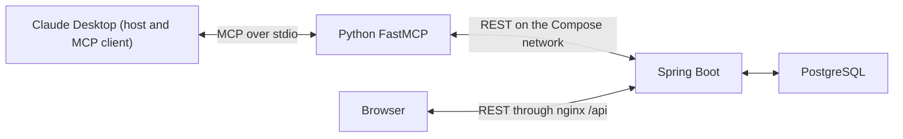

# Passenger Information Display System (PIDS)

Ein Web-Projekt zur Anzeige und Verwaltung von Zugfahrplänen in Echtzeit – ähnlich wie die Anzeigetafeln an Bahnhöfen oder Haltestellen.
Probieren Sie alle Tasten, die Sie auf der Webseite finden :)
---

## Live-Demo

Die Anwendung ist live unter **[salmanchik.com](http://salmanchik.com)** erreichbar.

> **Hinweis:** Die Benutzeroberfläche ist aktuell nur für Desktop-Bildschirme ausgelegt und noch nicht für Mobilgeräte optimiert. Auf Tablets muss es jedoch gut aussehen..

---

## Tech Stack

* **Backend:** Java, Spring Boot (Web, Data JPA, Validation), Hibernate
* **Datenbank:** PostgreSQL
* **Frontend:** HTML, CSS, TypeScript (Fetch API)
* **DevOps & Infrastructure:** Docker, Google Compute Engine (GCE), GitHub Actions (CI/CD), Gradle, Git

---

## Features & Architektur

* RESTful API für Fahrpläne und Echtzeit-Updates
* Package-by-Feature Struktur für gute Wartbarkeit
* Automatisierte CI/CD-Pipeline (Testing & Deployment bei jedem Push)
* Containerisierung der Datenbank via Docker

## Local MCP practice

### Start the app

Run this from the repository root with Docker running.

```sh
docker compose up --build -d
```

Open [the departure board](http://localhost:3000). **Aktuelle Verbindungen** shows the board with origin and ID filters. **Abfahrten verwalten** lets you add one or more departures, update an expected time by ID or origin, and delete by ID or by threshold. The visible board refreshes every three seconds.

Compose supplies local PostgreSQL defaults on a fresh checkout and uses your existing `.env` values if provided. `docker compose down` stops the services and keeps the database volume.

### Connect Claude Desktop over stdio

1. Open Claude Desktop's local MCP developer settings and select **Edit Config**. Depending on your version, look under **Settings → Desktop app → Extensions → Manage → Local MCP servers** or **Settings → Developer**. The file is `claude_desktop_config.json`. [Claude's local MCP setup guide](https://support.claude.com/en/articles/10949351-getting-started-with-local-mcp-servers-on-claude-desktop)
2. Add the entry below to `mcpServers`. Keep any other entries already in the file. Use the absolute paths to Docker and your checkout. On macOS or Linux, find them with `command -v docker` and `pwd`. On Windows PowerShell, use `(Get-Command docker.exe).Source` and `(Get-Location).Path` and double backslashes in JSON, for example `"C:\\Users\\you\\PassengerInformationDisplaySystem"`.

   ```json
   {
     "mcpServers": {
       "pids": {
         "command": "/opt/homebrew/bin/docker",
         "args": [
           "compose",
           "--project-directory",
           "/Users/you/Desktop/PassengerInformationDisplaySystem",
           "exec",
           "-T",
           "mcp",
           "python",
           "-u",
           "server.py"
         ]
       }
     }
   }
   ```

3. Quit Claude Desktop completely and reopen it. In chat, open **+ → Connectors** and check that `pids` shows its tools. Use a local Claude Desktop chat for this configuration. [MCP guide to connecting local servers](https://modelcontextprotocol.io/docs/develop/connect-local-servers)

The `mcp` Compose service keeps the Python environment running. Claude starts a FastMCP process inside it with `docker compose exec -T`. The `-T` flag disables the pseudo-terminal so the process can exchange protocol messages over standard input and output. Python runs inside Docker, so the host only needs Docker and the MCP client. If you recreate the containers, reconnect or restart Claude Desktop to start a fresh process. [Docker Compose exec reference](https://docs.docker.com/reference/cli/docker/compose/exec)

### Try these prompts

Use sample data when practicing deletion. A missing train line or destination can be left blank if you supply the origin. Origin matching ignores case and matches the whole station name. Hours use local 24-hour clock times, with no date or timezone.

1. “Add departures from Frankfurt, Darmstadt, and Mannheim. Set all three to platform Gleis 2, with scheduled times 13:00, 14:00, and 15:00 respectively. Leave train lines and destinations blank.”
2. “List departures from Mannheim. Set their expected departure time to 15:20.” If you leave out the time, Claude should ask for it. The bulk tool sets the same absolute time for each match.
3. “Show departures with IDs greater than 5. Once I confirm, delete those departures.” The deletion matches every ID strictly greater than 5, including rows on other pages. For a fresh database with only three rows, use a threshold of 1 to see it take effect.

Switch to **Aktuelle Verbindungen** in the browser and watch the changes. The browser and Claude share the same local database.

### What happens when Claude calls a tool



Claude Desktop is the **host**. It runs an MCP **client** that connects to the FastMCP **server**. A session starts with an `initialize` exchange to agree on the protocol version and capabilities. The client discovers tools with `tools/list`, which returns names, descriptions, and JSON schemas. When Claude selects a tool, the client sends `tools/call` with concrete arguments. For example, “set Mannheim to 15:20” becomes `set_live_times_by_origin` with `{"origin":"Mannheim","actual_time":"15:20"}`. The client can use the tool result, or an error, in its next response. MCP also supports **resources** for readable context and **prompts** for reusable interaction templates. This project only needs tools. [MCP architecture overview](https://modelcontextprotocol.io/docs/learn/architecture)

MCP is the protocol. FastMCP is the Python framework used here, and the official Python SDK is another option for implementing the same protocol. In [server.py](mcp-server/server.py), FastMCP builds schemas from type annotations and descriptions from docstrings. You could use `uv` to run a server directly on your host, as in the microfluidiCAD design. Here Docker provides Python and installs the dependencies. [FastMCP tools](https://gofastmcp.com/docs/servers/tools) · [Official Python SDK](https://github.com/modelcontextprotocol/python-sdk)

Each tool calls Spring over HTTP, using `http://app:8080` inside Compose. Spring owns persistence and validation, and each batch writes in a single database transaction. stdio carries MCP JSON-RPC messages, while the Spring API uses normal REST requests. A host can also speak MCP over Streamable HTTP to a network endpoint. This configuration uses stdio and requires no separate API key for the local adapter. Claude Desktop still uses your Claude account and can send tool inputs and results to the model. [MCP transports](https://modelcontextprotocol.io/specification/2025-11-25/basic/transports)

| MCP tool | Spring endpoint |
| --- | --- |
| `list_departures` | `GET /departures?origin=Mannheim&idGreaterThan=5&page=0` with optional filters |
| `get_departure` | `GET /departures/{id}` for scheduled details |
| `create_departures` | `POST /departures/batch` with a `departures` array |
| `set_live_departure_time` | `POST /departures/{id}/live` with `actualTime` |
| `set_live_times_by_origin` | `PATCH /departures/live` with `origin` and `actualTime` |
| `delete_departure` | `DELETE /departures/{id}` |
| `delete_departures_after_id` | `DELETE /departures?idGreaterThan=5` with a required threshold |

The original `POST /departures` still accepts a single departure. The board's list uses `tripId` for the ID, while the scheduled response uses `id`. Existing rows without an origin or platform display a dash for those fields.

### Debug one layer at a time

- **REST**. Run `curl http://localhost:3000/api/departures`. This checks nginx, Spring, and PostgreSQL. If it fails after startup, run `docker compose ps` and `docker compose logs app`. See [test.http](test.http) for more requests.
- **MCP**. From the repo root with Node.js installed, run the Inspector command below. Connect over **STDIO**, list the tools, and call `list_departures` directly. You can inspect the inputs and results without involving a model. Running just the underlying Docker command waits for MCP messages on stdin. [MCP Inspector docs](https://modelcontextprotocol.io/docs/tools/inspector)
- **Claude**. If the Inspector works and Claude cannot see the tool, check the config paths, confirm Docker is running, and inspect Claude Desktop's local MCP logs. On macOS, the logs are under `~/Library/Logs/Claude`. [Claude's local MCP troubleshooting guide](https://support.claude.com/en/articles/10949351-getting-started-with-local-mcp-servers-on-claude-desktop)

```sh
npx -y @modelcontextprotocol/inspector -- docker compose --project-directory "$PWD" exec -T mcp python -u server.py
```

### Apply the pattern to microfluidiCAD

The departure board is a small example of the same split. `list_departures` corresponds to inspecting the feature tree with `get_design`. `create_departures` and the live-time tools correspond to parametric commands such as `add_serpentine` and `update_feature`. Give those tools typed inputs, use stable feature IDs, and return the committed result or a validation error from Java.

In the CAD editor, both the browser and FastMCP should submit commands to the same Java state manager. It can serialize edits, run the JTS geometry validation, update the design and undo history, and publish the committed revision over WebSocket. Konva then updates the canvas regardless of which client initiated the command. Here the board uses polling to keep the demo small. In a CAD editor, the WebSocket carries application state updates independently of the Claude-to-FastMCP connection.
